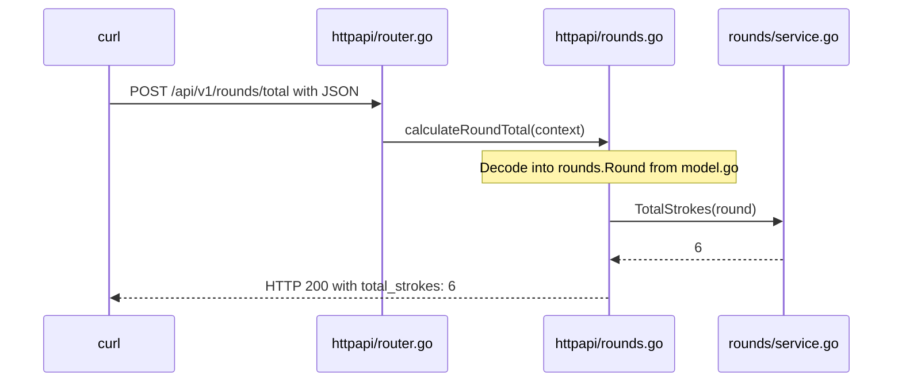

# Follow one round through the code

This example uses your existing Round, HoleScore, and TotalStrokes code.
It calculates a total without saving anything. Start here before implementing
database access or introducing more interfaces.

## Run it

In one terminal, from the repository root:

```sh
cd backend
go run ./cmd/api
```

In another terminal, also starting from the repository root:

```sh
cd backend
curl -i http://localhost:8080/api/v1/rounds/total \
  -H 'Content-Type: application/json' \
  --data-binary @examples/round.json
```

Expect HTTP 200 and `{"total_strokes":6}`. Edit the strokes in the sample and
send it again. The sample date is illustrative; no date format is enforced.
PostgreSQL and Astro do not need to be running for this exercise.

## Read these files in order

1. **`backend/cmd/api/main.go`** starts the application. It creates the router
   once, then starts listening for requests. Later, shared dependencies such as
   the database pool will be initialized here.
2. **`backend/internal/httpapi/router.go`** connects a URL and HTTP method to a
   function: POST `/api/v1/rounds/total` calls `calculateRoundTotal`.
3. **`backend/internal/httpapi/rounds.go`** is that handler. It decodes JSON into
   a Go value, calls the calculation, and sends JSON back. HTTP-specific concepts
   such as status codes belong here.
4. **`backend/internal/rounds/model.go`** defines the data being passed around.
   A struct is a description of data, not a database table or an HTTP endpoint.
5. **`backend/internal/rounds/service.go`** contains the calculation. It works
   with Go values and knows nothing about Gin, JSON requests, or PostgreSQL.
6. **`backend/internal/postgres/rounds.go`** is reserved for future SQL code.
   Nothing calls it yet because this operation does not save or load data.



The request passes a value to a function; it does not execute each file in order.
The router determines which function runs. Package names distinguish the two
`rounds.go` files: one handles HTTP, the other will handle PostgreSQL.

## Tests and current limits

From `backend/`, run `go test ./...`.

- `rounds/service_test.go` checks the calculation directly.
- `httpapi/rounds_test.go` sends the example through the router in memory and
  checks malformed JSON and incorrect field types.
- Missing fields become Go zero values. An omitted holes list totals zero.
- No business validation is implemented: negative scores and duplicate holes
  are not rejected yet. Decide those rules yourself before adding storage.
- `ConvertToStringDate` remains your unused placeholder.

The example uses curl so you can learn the backend separately. To call this POST
endpoint from Astro later, add shared CORS handling including OPTIONS preflight;
the existing CORS header on GET `/healthz` only covers that route.

## Your next small exercise

Add a pure function that calculates total par and a test for it. Then decide how
to expose that result in the HTTP response and update `docs/api.yaml`. Once the
request flow feels clear, add validation, followed by a separate save operation.
